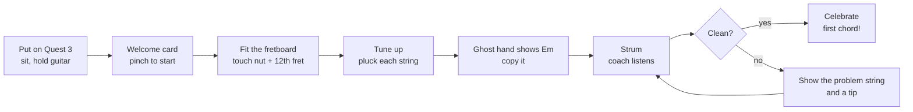
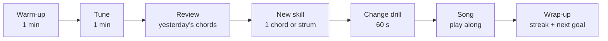
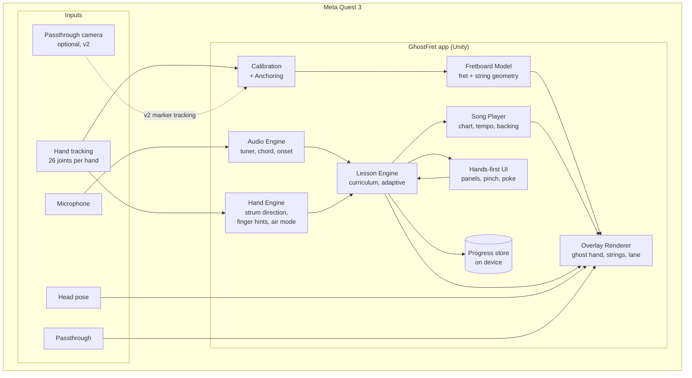
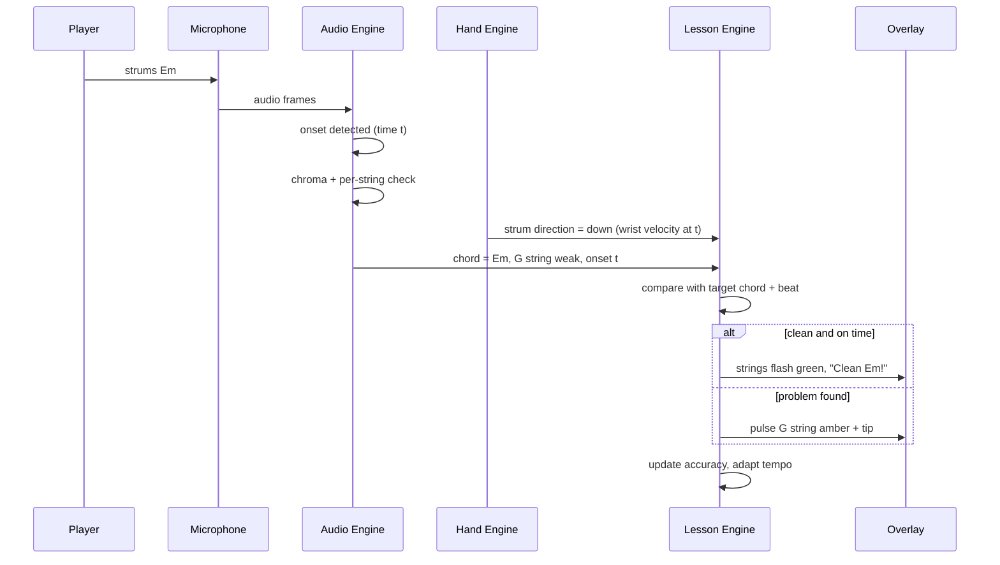
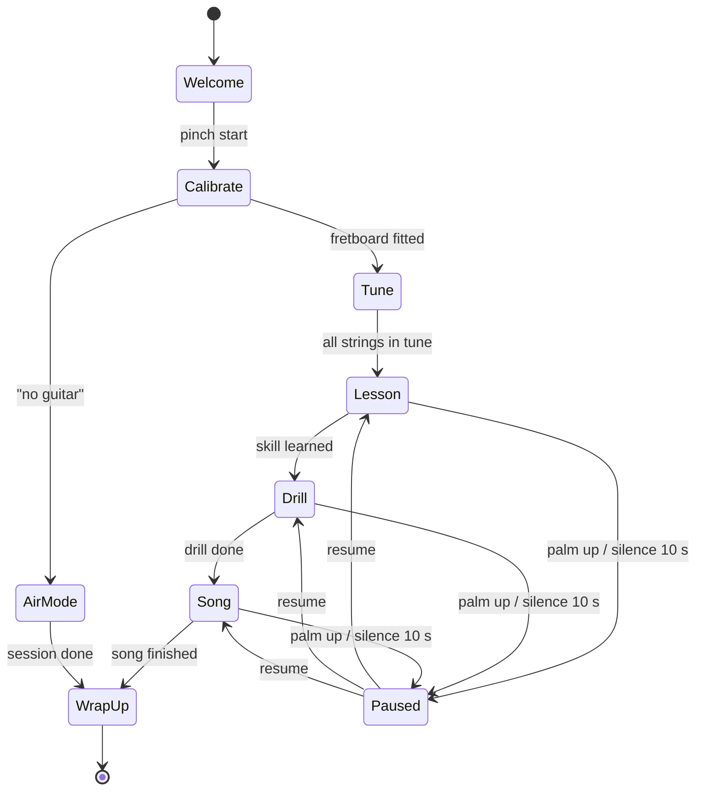
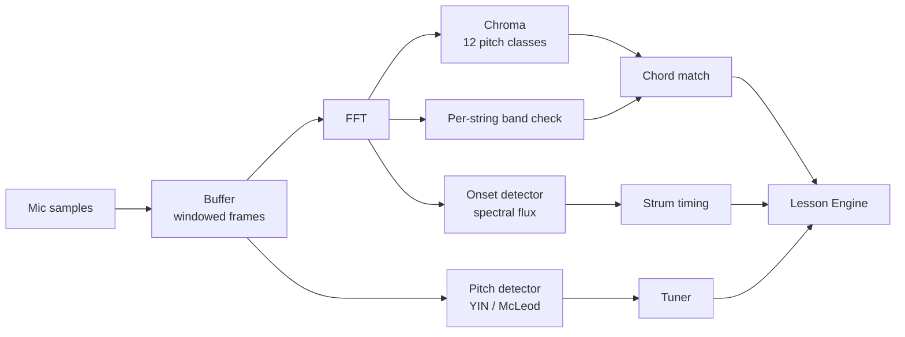

# GhostFret — Design Document

> Learn guitar on your **real guitar**, with a **ghost hand** showing exactly where your fingers go, a coach that **listens** to every chord, and a strumming guide that keeps you in time. Mixed reality on Meta Quest 3.

**Working name:** GhostFret (check the Meta Horizon Store and trademarks before final use)
**Device:** Meta Quest 3 / 3S (mixed reality, hand tracking, microphone)
**Competition:** Meta VR Start Developer Competition 2026
**Track:** Productivity (recommended) or Gaming (see §13.1) · **Division:** New Experience
**Award targets:** Best Reason to Come Back · Best First Five Minutes · Best Accessibility Forward Experience (secondary)
**Companion files (next):** `README.md` · `PLAN.md` · `PROGRESS.md` · `CLAUDE.md`

---

## Contents

1. [The story](#1-the-story)
2. [The problem: why beginners quit](#2-the-problem-why-beginners-quit)
3. [What already exists, and our edge](#3-what-already-exists-and-our-edge)
4. [Goals and success measures](#4-goals-and-success-measures)
5. [The experience](#5-the-experience)
6. [Learning design](#6-learning-design)
7. [Feature specs](#7-feature-specs)
8. [Architecture](#8-architecture)
9. [Tech stack and engine decision](#9-tech-stack-and-engine-decision)
10. [Mixed reality integration in depth](#10-mixed-reality-integration-in-depth)
11. [Audio engine in depth](#11-audio-engine-in-depth)
12. [Data model](#12-data-model)
13. [Competition fit](#13-competition-fit)
14. [Accessibility](#14-accessibility)
15. [Songs, content and licensing](#15-songs-content-and-licensing)
16. [Policy, privacy and safety](#16-policy-privacy-and-safety)
17. [Risks and fallbacks](#17-risks-and-fallbacks)
18. [Roadmap](#18-roadmap)
19. [Sources](#19-sources)

---

## 1. The story

### Meet Riya (a fictional beginner)

Riya, 19, got a guitar for her birthday. She watched three YouTube tutorials. Each time she had to:

1. pause the video,
2. squint at the teacher's fingers (mirrored, from a weird angle),
3. look down at her own fretboard and guess which string is which,
4. press, strum, and hear something buzzy and wrong,
5. not know *what* was wrong.

After two weeks of sore fingertips and buzzy chords, the guitar went into the corner.

### Riya with GhostFret

1. She puts on her Quest 3, sits down, and holds her guitar. Through passthrough she sees her real room and her real guitar.
2. She touches the guitar's nut and the 12th fret with her fingertip. **A glowing fretboard snaps onto her real neck.**
3. GhostFret listens while she plucks each string: a floating tuner tells her *"Low E: tune up a little"* until all six strings glow green.
4. A **ghost hand** appears on her real fretboard, fingers already in an E minor shape. She copies it. She strums.
5. GhostFret **hears** the chord: *"Great Em! The G string was a bit muted, so press a little closer to the fret."* The G string glows to show her which one.
6. A strumming lane next to the guitar shows down and up arrows in time with a soft beat. She strums along; it tells her she's rushing slightly.
7. Fifteen minutes later she plays her first full song, two chords, start to finish, with a backing track.

She didn't have to look away, pause a video, or guess what went wrong. **She saw it on her guitar, heard what was wrong, and knew how to fix it.**

### Pitch

> **"YouTube shows you a guitar. GhostFret shows you *your* guitar, then listens and tells you exactly what to fix."**

---

## 2. The problem: why beginners quit

- **90% quit in the first year.** Fender found that about 45% of guitars it sells go to new players, and 90% of those players abandon the instrument within their first year. Fender's CEO called it a retention problem, not an attraction problem. ([MusicRadar](https://www.musicradar.com/amp/news/90-of-beginner-guitar-players-give-up-within-a-year-says-fender))
- **Songs are too hard, too soon.** Few songs are beginner-friendly from start to finish, even when the famous riff is easy. ([Study Guitar](https://study-guitar.com/blog/why-beginners-quit/))
- **It stops being fun.** Beginners get discouraged and frustrated, and practice feels grueling. ([Calendar UK FAQ](https://calendar-uk.co.uk/frequently-asked-questions/why-do-most-guitar-players-quit))

From these sources and common teaching experience, the concrete blockers for a beginner are:

| Blocker | What the beginner experiences | How GhostFret answers it |
|---|---|---|
| **Where do my fingers go?** | Diagrams and videos are flat, mirrored and far away | Ghost hand on your **own** fretboard, from your own point of view |
| **What did I do wrong?** | A chord sounds bad; no idea why | Audio check names the problem string and why |
| **Chord changes are slow** | Can hold a chord, can't switch in time | Timed change drills, slowed songs that speed up as you improve |
| **Strumming rhythm** | Strumming feels random; songs fall apart | Strum lane with down/up arrows + timing feedback |
| **Out of tune** | Everything sounds wrong even when fingers are right | Built-in tuner as step one of every session |
| **Too hard, too soon** | First "easy" song has an F barre chord | Curriculum unlocks songs only after their chords are learned; simplified arrangements |
| **Sore fingertips** | Long sessions hurt; quit | Short sessions (10 to 15 min) with built-in rests |
| **Boredom** | Exercises feel like homework | Real songs from day one, streaks, visible progress |

---

## 3. What already exists, and our edge

| Product | What it does | Gap we fill |
|---|---|---|
| **IMMERROCK** (Quest, early access) | MR guitar learning, 300+ gamified exercises | Its store page says note detection is still being worked on ([QuestStoreDB](https://queststoredb.com/app/immerrock/7334845636643834)). GhostFret **listens** and gives per-string feedback |
| **GuitarXR** (Quest) | AR guitar experience, upload your own tabs | Small user base; we focus on beginner pedagogy + listening coach |
| **Bad Guitar VR** (SideQuest) | Scale suggestions + backing tracks on the fretboard, for improvisation | Aimed at harmony/improv, not first-time beginners |
| **RizzRiff** (open source) | Tuner, pitch detection, visual fretboard in MR | A weekend prototype; single notes, no chords or strumming |
| **AxAR** (NYU thesis) | AR guitar learning on Quest 3 with hand tracking + audio | Research prototype, not a product |
| **Unplugged: Air Guitar** | Air-guitar rhythm game | No real guitar, so skills don't transfer to a real instrument |
| **Guitar Tuna / Yousician** (phone) | Tuner, audio-checked lessons on a screen | You look at a phone, not your fretboard |

**Our edge, in one line:** the only beginner-first MR coach that combines **ghost-hand finger placement on your real guitar**, **listening chord and strum feedback**, and a **curriculum built around why beginners quit**.

---

## 4. Goals and success measures

| Goal | Measure (for testing with real beginners) |
|---|---|
| First win fast | A complete beginner plays a clean Em chord within 5 minutes of putting on the headset |
| First song fast | Plays a full two-chord song within 15 minutes |
| Know what's wrong | After a bad chord, the player can say which string was wrong (from the feedback) |
| Come back | Player returns for a second session the next day |
| Transfer | After a week, player can play learned chords **without** the overlay (overlay-fade mode) |

---

## 5. The experience

### 5.1 First five minutes



| Time | What happens |
|---|---|
| 0:00 | Passthrough room. Card: "Grab your guitar and sit comfortably. Pinch to start." |
| 0:20 | **Fit the fretboard** (§10.2): touch three points; a glowing fretboard snaps onto the real neck |
| 1:30 | **Tune** (§7.1): pluck each string; arrows say tune up/down; strings turn green |
| 3:00 | **First chord** (§7.2): ghost hand shows Em (two fingers). Strum. Coach checks |
| 4:00 | **First win**: "That's your first chord!" with a soft chime and a confetti burst near the guitar |
| 4:30 | Choose: "Learn a second chord" or "Strum along with a beat" |

### 5.2 A normal daily session (10 to 15 minutes)



| Step | Time | Purpose |
|---|---|---|
| Warm-up | 1 min | Finger stretches shown by the ghost hand (gentle, optional) |
| Tune | 1 min | Every session starts in tune |
| Review | 2 min | Chords from previous sessions, checked by audio |
| New skill | 3 min | One new chord or strum pattern |
| Change drill | 1 to 2 min | "How many clean switches between Em and G in 60 seconds?" |
| Song | 3 to 5 min | Play along with a backing track, slowed to your level |
| Wrap-up | 30 s | Streak, today's best, tomorrow's goal |

**Pause anytime:** lift the strumming hand, turn the palm up and hold still (no pinch, see §13.3). Or simply stop playing for 10 seconds: GhostFret notices silence and offers a pause.

### 5.3 Modes

| Mode | What it is | Needs a real guitar? |
|---|---|---|
| **Tuner** | Guitar Tuna-style tuner floating at your headstock | Yes |
| **Chord Coach** | Ghost hand + listening chord check | Yes |
| **Strum Coach** | Rhythm lane + strum direction and timing feedback | Yes (or Air mode) |
| **Change Drill** | Timed chord-switching challenge | Yes |
| **Song Mode** | Play full songs with chords, strum lane and backing track | Yes |
| **Air Guitar Practice** | Virtual guitar on your lap; practise shapes and strumming with hand tracking only | **No.** Also lets judges and guitar-less users complete the experience |

---

## 6. Learning design

Principles that guide every feature:

1. **Show it where it happens.** Instructions appear on or next to the real fretboard, never on a distant screen.
2. **One thing at a time.** Each step teaches a single skill: one chord, one strum pattern, one change.
3. **Hear, then fix.** Every attempt gets specific feedback ("G string muted") and one tip, not a score alone.
4. **Slow first, then speed up.** Songs start slow and speed up automatically as accuracy improves.
5. **Short and often beats long and rare.** Sessions of 10 to 15 minutes, with a daily streak.
6. **Real songs early.** A two-chord song on day one; new songs unlock as chords are learned.
7. **Fade the help.** The overlay gradually fades so skills transfer to playing without the headset.
8. **Never shame.** Mistakes replay slower; no harsh fail sounds; celebrate small wins.

### 6.1 Beginner curriculum (first two weeks)

| Day | New skill | Song unlocked (public domain, simplified) |
|---|---|---|
| 1 | Tuning, holding, **Em**, down strums on the beat | "Em Groove" (original) |
| 2 | **D**, Em ↔ D change | "Drunken Sailor" in Em (Em/D) |
| 3 | **G** (simplified 3-finger), down-down-up pattern | "Clementine" (G/D) |
| 4 | **C**, G ↔ C change | "Amazing Grace" (G/C/D) |
| 5 | **Am**, the classic D-DU-UDU pattern | "Oh Susanna" (G/C/D) |
| 6 | **A**, **E** | "When the Saints Go Marching In" in A (A/D/E) |
| 7 | Review + speed-up challenge | Player's choice of unlocked songs |
| 8–14 | Smooth changes, **Dm**, mini-F (no full barre) | "House of the Rising Sun" (Am C D F E, mini F) |

### 6.2 Adaptive difficulty

| Signal | Adjustment |
|---|---|
| Clean chord rate below 60% in a song | Slow the song 10%; show ghost hand earlier before each change |
| Clean chord rate above 90% for two runs | Speed up 5% toward the original tempo |
| Repeated mute on one string | Show a focused tip and a 30-second drill for that finger |
| Long pause or slow changes | Offer a change drill for that chord pair |
| Session over 15 minutes | Suggest a break (fingertip comfort) |

---

## 7. Feature specs

### 7.1 Tuner

- **Input:** mic audio, single plucked string.
- **Detection:** fundamental frequency with a pitch algorithm (YIN or McLeod), standard tuning E2 A2 D3 G3 B3 E4.
- **Auto string detection:** nearest standard string to the detected pitch.
- **Display:** a dial floating just above the headstock anchor, plus the matching string glowing on the overlay (red = flat/sharp, green = in tune within ±5 cents).
- **Words:** "Tune up a little" / "Tune down" / "Perfect".
- **Extras:** alternate tunings (Drop D, half-step down) in settings.

### 7.2 Chord Coach

- **Ghost hand:** a translucent hand model posed in the chord shape, placed on the real fretboard using calibrated fret positions. Each fingertip has a numbered dot (1 index, 2 middle, 3 ring, 4 pinky).
- **String markers:** strings to strum glow; strings to skip show an "×"; open strings show an "○".
- **Listening check:** after a strum, the chord detector (§11.3) compares the sound to the target chord.
- **Feedback types:**

| Result | Message | Visual |
|---|---|---|
| Clean | "Clean Em!" | All target strings flash green |
| One string muted | "G string is muted. Arch your finger so it doesn't touch it." | That string pulses amber |
| One string buzzing | "Buzz on the A string. Press closer to the fret." | Amber pulse + arrow toward the fret |
| Wrong chord | "That sounds like G, not Em. Check the ghost hand." | Ghost hand pulses |
| Strummed a string to skip | "Try not to hit the low E for this chord." | Low E shows "×" pulse |

- **Hand hints (optional):** where hand tracking is confident, a dot shows if a fingertip is on the wrong fret. Audio stays the source of truth (§10.4).

### 7.3 Strum Coach

- **Rhythm lane:** a vertical lane beside the guitar body; down (↓) and up (↑) arrows scroll toward a hit line in time with the tempo.
- **Timing:** onset detection on the mic audio gives the exact time of each strum.
- **Direction:** strumming-hand wrist velocity from hand tracking gives down vs up (the strumming hand is rarely blocked by the guitar neck, so tracking is more reliable than for the fretting hand).
- **Feedback:** "On time", "A little early (rushing)", "Late (dragging)", "Missed the up-strum".
- **Patterns:** quarter downs → D-D-U → D-DU-UDU → reggae off-beat (later).
- **Metronome:** soft click + visual pulse; tempo slider.

### 7.4 Change Drill

- "How many clean switches between **Em** and **G** in 60 seconds?"
- Each clean target chord counts; the ghost hand shows the next shape as soon as the current one is detected.
- Best score saved per chord pair; this drill is the single best predictor of being able to play songs.

### 7.5 Song Mode

- **Chart:** chord names above the rhythm lane; ghost hand morphs to the next shape one beat before each change.
- **Backing track:** original or public-domain arrangement (drums + bass + soft keys), no vocals.
- **Tempo:** starts at the player's comfort tempo; adaptive (§6.2).
- **Sections:** loop any section (pinch the section name).
- **Score:** clean chord %, timing %, longest streak. Shown as a gentle summary, not a harsh grade.

### 7.6 Air Guitar Practice

- **Why:** lets anyone (and competition judges) complete the experience without a guitar, and lets players practise shapes on the go.
- **Virtual guitar** rests at lap height, sized to an average guitar.
- **Fretting hand:** finger joint pose is matched to chord shape templates (approximate).
- **Strumming hand:** wrist velocity across the virtual strings triggers strums; the app plays a sampled chord sound.
- **Honesty note in UI:** "Air mode practises shapes and rhythm. Real-guitar mode checks your actual sound."

---

## 8. Architecture

Everything runs **on the headset**. No server is needed for the core experience.



**How to read it**
- **Calibration** turns three fingertip touches into a **Fretboard Model** (where every fret and string is in 3D).
- **Audio Engine** is the judge of what was actually played. **Hand Engine** adds strum direction and optional finger hints.
- **Lesson Engine** decides what to teach next and how to react. **Song Player** runs timing for songs.
- **Overlay Renderer** draws everything onto the real guitar in passthrough.

### 8.1 One strum, from sound to feedback



### 8.2 Session state machine



---

## 9. Tech stack and engine decision

### 9.1 Decision: Unity + Meta XR SDK

| Need | Unity (Meta XR SDK) | WebXR (IWSDK) |
|---|---|---|
| Passthrough camera for guitar/marker tracking | **Supported.** Passthrough Camera API on Quest 3/3S since Horizon OS v74, shippable in store apps | **Not available.** WebXR `camera-access` is rejected in Quest Browser as of early 2026 |
| Microphone + low-latency audio DSP | Native mic, C# DSP | Possible via Web Audio, more latency uncertainty |
| Hand tracking quality and API | Full Meta Interaction SDK | Good |
| Prior art | RizzRiff and AxAR (Quest 3 guitar prototypes) used Unity | None found |
| Distribution | APK to "Competition" release channel + invite URL | Hosted link |
| Claude Code workflow | Code in C#; scene setup in the Unity Editor by hand | Code-only |

**Choice: Unity.** The guitar is a physical object we must line up with precisely, and only native apps can use the cameras to help with that. Audio quality matters more here than in any earlier idea.

### 9.2 Stack

| Layer | Choice | Why |
|---|---|---|
| Engine | Unity 6 LTS + **Meta XR All-in-One SDK** (v81+ as suggested by the competition) | Official Quest path; passthrough, hands, interaction |
| Language | C# | Unity standard; Claude Code writes it well |
| Hands + UI | Meta Interaction SDK (poke, pinch, ray) | Hands-first panels and buttons |
| Hand joints | OVRSkeleton / OpenXR hand tracking | Strum direction, finger hints, air mode |
| Passthrough + MR | Passthrough layer + Mixed Reality Utility Kit (MRUK) | Real-world view, room/desk context |
| Camera (v2) | Passthrough Camera API + marker detection | Auto-align fretboard using a small sticker on the headstock |
| Audio input | Unity `Microphone` | Raw mic samples on device |
| Pitch | YIN / McLeod pitch method (C#) | Accurate monophonic tuner |
| Chords | FFT → chroma (12 pitch classes) → template matching, plus per-string band check | Works for beginner open chords; light enough for the headset |
| Onsets | Spectral flux onset detection | Strum timing |
| ML (optional, v2) | Unity Sentis running a small chord model | Better accuracy on noisy rooms |
| Data | JSON song charts + local save (`Application.persistentDataPath`) | Simple, on-device |
| Audio output | Unity audio, spatialised near the guitar | Backing tracks, metronome, chimes |
| Testing without headset | Meta XR Simulator for UI/flow (no camera API in simulator) | Faster iteration |
| Version control | Git + GitHub (Git LFS for audio/models) | Large assets |
| AI tooling | Claude Code (scripts, tests, docs) | Build speed |

---

## 10. Mixed reality integration in depth

### 10.1 What we use from the headset

| Capability | Used for |
|---|---|
| **Passthrough** | See the real guitar, room and hands |
| **Hand tracking** | Calibration touches, strum direction, finger hints, UI pinch/poke, air mode |
| **Head pose** | Place UI in view; keep the overlay stable |
| **Microphone** | Tuner, chord check, strum timing |
| **Passthrough Camera API (v2)** | Automatic fretboard alignment from a headstock marker |
| **Spatial anchor (optional)** | Remember where the player usually sits with the guitar stand |

### 10.2 Fitting the fretboard (calibration)

The player touches three points with the **index fingertip**, holding each for one second:

| Touch | Point |
|---|---|
| 1 | Nut, low E side |
| 2 | Nut, high E side |
| 3 | 12th fret, low E side |

From these three 3D points:

```
neckAxis      = normalize(P3 − P1)                 // along the neck toward the body
scaleLength   = 2 × |P3 − P1|                      // 12th fret sits at half the scale
nutWidth      = |P2 − P1|
fretPlane     = plane through P1, P2, P3
fretDistance(n) = scaleLength × (1 − 2^(−n/12))    // nut to fret n (equal temperament)
stringPos(s, n) = P1 + neckAxis × fretDistance(n)
                  + across × (s/5) × widthAt(n)    // s = 0..5, low E to high E
```

- `widthAt(n)` widens slightly toward the body (default taper; adjustable).
- Typical results land near common scale lengths (≈ 628 to 650 mm), which is a built-in sanity check: if the measured length is far off, ask to redo.
- Fingertip touch accuracy is a few millimetres off, so we **snap** to the nearest common scale length if within tolerance.

### 10.3 Keeping it aligned when the guitar moves

A seated player's guitar shifts a little all the time. In order of build priority:

1. **Seated, stable posture guidance:** short tip in calibration ("rest the guitar on your leg; keep it still").
2. **Quick re-fit:** touch the nut for one second at any time to re-anchor (keeps the angle, updates position).
3. **Fretting-hand follow (v1.5):** the fretting hand's knuckles move with the neck; small consistent shifts of the hand nudge the overlay.
4. **Audio-assisted correction (v1.5):** if the audio says a note is at fret 3 but the fingertip is drawn over fret 2 repeatedly, shift the model.
5. **Headstock marker (v2):** a small printed marker on the headstock, tracked with the Passthrough Camera API, keeps the overlay locked. Note: the camera stream is lower resolution than what the user sees and isn't suited to fast-moving objects or fine detail, so we use a large, simple marker and smooth the result.

### 10.4 Hand tracking: what we trust it for

Fingers wrapped around a guitar neck block the headset cameras' view, and self-occlusion is a known hard problem for XR musical instruments. So:

| Task | Rely on hand tracking? | Why |
|---|---|---|
| Calibration touches | **Yes** | Single fingertip, clear view |
| Strum direction | **Yes** | Strumming hand is mostly unblocked |
| UI (pinch, poke) | **Yes** | Hands free from the guitar |
| Exact fretting finger positions | **Hints only** | Fingers hidden behind the neck |
| Was the chord correct? | **No: audio decides** | Sound is the ground truth |

### 10.5 Overlay rendering

- **Fretboard:** thin glowing lines for frets, faint lines for strings; drawn slightly above the real surface to avoid flicker.
- **Ghost hand:** translucent, soft-edged, offset slightly toward the player so it never looks "inside" the wood.
- **Occlusion:** the player's real hands render on top of the overlay (hand mask), so the ghost hand never covers their own fingers.
- **Readability:** labels face the player, sit just above the neck, never on the strings themselves.
- **Comfort:** no flashing; gentle pulses only.

### 10.6 Hands-first UI while holding a guitar

| Situation | Interaction |
|---|---|
| Both hands free | Pinch or poke panels |
| Holding the guitar | Lift the strumming hand and poke a small panel beside the guitar body |
| Mid-song | Stop playing → auto-pause after silence; palm-up pause |
| Confirm "ready" | Strum once ("strum to start") |
| Choosing a chord or song | Large cards within easy reach; poke to select |

The entire experience is completable with hands only and never needs a controller.

---

## 11. Audio engine in depth

### 11.1 Pipeline



### 11.2 Tuner
- Monophonic pitch detection for one string at a time.
- Smooth the reading over a short window; show "listening…" until stable.
- Accuracy target: ±5 cents shown as in tune.

### 11.3 Chord detection
1. Detect a strum onset.
2. Take the next short window of audio after the attack.
3. Compute **chroma**: how much energy each of the 12 note names has.
4. Compare with **templates** for the target chord and similar chords (cosine similarity).
5. **Per-string check:** for each string the chord should sound, look for energy at that string's expected note and its harmonics. Missing or weak energy suggests a muted string; noisy, smeared energy near it suggests buzz.
6. Return: detected chord, confidence, list of weak strings.

Start with the beginner chord set: Em, G, D, C, Am, A, E, Dm, simplified F.

### 11.4 Strum timing
- Spectral flux onset detection gives strum times.
- Compare with the beat grid: early, on time, late.
- Measure and compensate **mic latency** once per device with a calibration step ("strum on the four clicks").

### 11.5 Robustness
- **Noise gate** below a set level.
- **Acoustic vs electric:** acoustic works with the headset mic; electric guitars need an amp in the room (no cable input on Quest).
- **Backing track bleed:** play backing tracks at a moderate volume and subtract known backing-track content where possible; recommend headphones or lower volume if detection drops.

---

## 12. Data model

### 12.1 Song chart (`songs/amazing-grace.json`)

```json
{
  "id": "amazing-grace",
  "title": "Amazing Grace",
  "source": "Traditional (public domain), simplified arrangement",
  "difficulty": 2,
  "chordsRequired": ["G", "C", "D"],
  "timeSignature": [3, 4],
  "originalBpm": 80,
  "strumPattern": ["D", "D", "U"],
  "backingTrack": "audio/amazing-grace-backing.ogg",
  "sections": [
    { "name": "Verse", "bars": [
      { "chord": "G", "beats": 3 }, { "chord": "G", "beats": 3 },
      { "chord": "C", "beats": 3 }, { "chord": "G", "beats": 3 }
    ]}
  ]
}
```

### 12.2 Chord shape (`chords/Em.json`)

```json
{
  "name": "Em",
  "frets": [0, 2, 2, 0, 0, 0],
  "fingers": [0, 2, 3, 0, 0, 0],
  "mutedStrings": [],
  "pitchClasses": ["E", "G", "B"]
}
```
(`frets` and `fingers` go from low E to high E; 0 = open string.)

### 12.3 Progress (on device only)

```json
{
  "streakDays": 4,
  "lastSession": "local-date",
  "chords": { "Em": { "cleanRate": 0.92 }, "G": { "cleanRate": 0.71 } },
  "changes": { "Em-G": { "best60s": 14 } },
  "songs": { "amazing-grace": { "bestClean": 0.85, "tempoReached": 72 } },
  "settings": { "leftHanded": false, "tuning": "standard", "overlayFade": 0.0 }
}
```

---

## 13. Competition fit

### 13.1 Track choice

| Option | Fit | Notes |
|---|---|---|
| **Productivity (recommended)** | "Creative tools, or habits tied to a recurring context" | Daily practice habit + learning tool; fewer direct competitors than Gaming |
| Gaming | Works if Song Mode is framed as a rhythm game | Larger prize, but judged against pure games |

Decide before submission; this document assumes Productivity.

### 13.2 Design tests

| Test | How GhostFret passes |
|---|---|
| **Hands-first** ("complete without pairing a controller") | All UI is pinch/poke; Air Guitar mode lets anyone complete it even without a guitar |
| **Airplane seat** (two-foot radius) | Seated by nature; everything sits on or beside the guitar |
| **One bus stop** (a complete moment fast) | Tune + one chord + one strum in under 5 minutes; daily sessions 10 to 15 minutes |
| **Take it away** (not a wrapper) | All core tech is ours: calibration, audio engine, lessons. No third-party service needed |

### 13.3 Platform gesture rule

On Quest, a pinch with the **palm facing the headset** is the system menu gesture and must not trigger app actions. Our pause is **palm up and still, with no pinch**, and our UI pinches happen with the palm facing away.

### 13.4 Special awards

| Award | Why we fit |
|---|---|
| **Best Reason to Come Back** | Daily streaks, songs unlock as you learn, visible progress, change-drill high scores |
| **Best First Five Minutes** | First real chord on your own guitar within five minutes |
| **Best Accessibility Forward** | Left-handed mode, colour-blind-safe cues, captions for all audio feedback, seated, short sessions (§14) |

---

## 14. Accessibility

| Feature | Who it helps |
|---|---|
| **Left-handed mode** (mirrored fretboard and ghost hand) | Left-handed players, often ignored by learning tools |
| Colour + shape + text for every cue (green ✓, amber !, ×, ○) | Colour-blind players |
| Text captions for all spoken or sound feedback | Deaf and hard-of-hearing players |
| Adjustable overlay brightness and size | Low-vision players; bright rooms |
| Tempo control on everything | Players who need more time |
| Seated, short sessions, auto-pause on silence | Everyone; players who tire quickly |
| Simplified chord shapes (e.g. 3-finger G, mini-F) | Smaller hands; early beginners |
| Air mode | People without a guitar yet |

---

## 15. Songs, content and licensing

- **Launch library: public domain only**, with our own simplified arrangements and our own backing tracks (no vocals, no copied recordings).
  - Examples: Amazing Grace, Clementine, Drunken Sailor, Scarborough Fair, When the Saints Go Marching In, Oh Susanna, House of the Rising Sun (traditional), Greensleeves (fingerpicking, later).
- **No copyrighted lyrics, recordings or copied tabs.** Famous modern songs need licences; see Roadmap.
- **Original exercises and grooves** written by us for chord and strum practice.
- **Custom charts (later):** players can enter their own chord sequences for personal use.

*Not legal advice: check any song's status before adding it.*

---

## 16. Policy, privacy and safety

| Area | Approach |
|---|---|
| **Microphone** | Audio is processed live on the headset and never recorded, stored or uploaded. Ask permission with a clear reason. |
| **Hand data** | Used live only for interaction and coaching; never stored or sent. |
| **Passthrough camera (v2)** | Camera images are user data under Meta's Developer Data Use Policy. Processed on device only for marker tracking; never saved or sent. |
| **Progress data** | Stored locally on the device only; delete option in settings. |
| **Health wording** | No health claims. "Fingertip comfort" and "take a break" are practice tips, not medical advice. |
| **Content** | Public domain and original only (§15). |
| **Comfort** | Seated, passthrough, no locomotion, no flashing effects. |

---

## 17. Risks and fallbacks

| Risk | Fallback |
|---|---|
| Overlay drifts as the guitar moves | Quick re-fit touch; hand follow; marker tracking in v2 |
| Calibration touches are inaccurate | Snap to common scale lengths; offer redo; visual "does this line up?" check |
| Chord detection struggles in noisy rooms | Noise gate, lower backing volume, "quiet room" tip; confidence threshold, so we stay silent rather than give wrong feedback |
| Per-string feedback gives a false alarm | Only show a string problem when confident; otherwise show a general tip |
| Fretting finger tracking unreliable | Audio decides correctness; finger hints only when confident |
| Electric guitar too quiet acoustically | Recommend a small amp; acoustic first-class |
| Mic latency varies | One-time latency calibration step |
| Judges have no guitar | Air Guitar mode completes the full first lesson and a song |
| Store already has MR guitar apps | Differentiate on listening feedback, beginner curriculum and ghost hand |
| Scope creep | Build order in PLAN.md: Tuner → Calibration → Chord Coach → Strum Coach → Song Mode → Air mode → polish |

---

## 18. Roadmap

| Stage | Features |
|---|---|
| **v1 (competition)** | Calibration, tuner, Chord Coach (9 chords), Strum Coach, Change Drill, Song Mode (6 to 8 public-domain songs), Air mode, left-handed mode, streaks |
| **v1.5** | Hand-follow + audio-assisted drift correction, overlay fade mode, fingerpicking basics |
| **v2** | Headstock marker tracking (Passthrough Camera API), on-device ML chord model, barre chords |
| **v3** | Licensed song catalogue, custom song import, teacher mode (a teacher joins remotely and sees your ghost hand), multiplayer jam |
| **Beyond** | Bass and ukulele (same pipeline, different string sets), Meta VR Glasses version |

---

## 19. Sources

- [MusicRadar: 90% of beginner guitar players give up within a year, says Fender](https://www.musicradar.com/amp/news/90-of-beginner-guitar-players-give-up-within-a-year-says-fender)
- [Study Guitar: why beginners quit](https://study-guitar.com/blog/why-beginners-quit/)
- [IMMERROCK on QuestStoreDB](https://queststoredb.com/app/immerrock/7334845636643834)
- [GuitarXR on QuestStoreDB](https://queststoredb.com/app/guitarxr-7203991546324534/)
- [Bad Guitar VR (itch.io)](https://bad-guitar.itch.io/bad-guitar-vr)
- [RizzRiff (GitHub listing)](https://awesome.ecosyste.ms/projects/github.com%2Fsaurabhchalke%2Frizzriff)
- [AxAR: An AR Guitar Learning Tool (NYU ITP thesis)](https://itp.nyu.edu/thesis/archive/2024/?p=1535)
- [Road to VR: Unplugged review](https://www.roadtovr.com/?p=104890)
- [Meta: Passthrough Camera API overview (Unity)](https://developers.meta.com/horizon/documentation/unity/unity-pca-overview/)
- [UploadVR: Passthrough Camera API now shippable on the store](https://www.uploadvr.com/quest-passthrough-camera-api-now-shippable-on-store/)
- [Meta forum: WebXR camera-access not supported in Quest Browser](https://communityforums.atmeta.com/questions-and-discussions-26/request-webxr-raw-camera-access-camera-access-feature-in-quest-browser-177407)
- [arXiv: self-occlusion in hand tracking for XR musical instruments](https://arxiv.org/pdf/2307.10203v1)
- [Meta VRC.Quest.Input.8: system gesture reserved](https://developers.meta.com/horizon/resources/vrc-quest-input-8/)
- [Meta VR Start Developer Competition 2026](https://start-developer-competition-26.devpost.com/)
